# 矿域 ORE.ZONE

一个受 **evm.zone** 启发、但机制完全独立的「三势力 + 链上 NFT 士兵 + 婚育 + 士兵市场 + 烧兵提取 + 球面抢矿」**网页游戏**。没有原作复刻资产。**游戏开局没有免费士兵**：连接 BSC Testnet 钱包并持有士兵 NFT，链上士兵才会同步为游戏军团。

无需构建、无需后端。直接打开 `index.html` 即可玩；进度存在浏览器 `localStorage`。

视觉方向：**会自转的球体战场**、墨色战桌、羊皮纸按钮、144 块球面领地、三座等距基地、阵营色重装骑士行军——刻意避开原作的黑色霓虹与不规则多边形。

```
open index.html
# 或者
python3 -m http.server 8080   # 然后访问 http://localhost:8080
```

---

## 一分钟玩法

1. 选择 **南极王国 / 森林王国 / 沙漠王国** 之一入伍。
2. 入伍获得 **10,000 ORE 军饷、47 块矿脉和 1 座基地**，但**初始军团为 0**；连接钱包并铸造 BSC Testnet 士兵 NFT 后，链上持有几个 NFT，游戏里就有几个士兵。地块产出按天从 8000 万游戏矿池中释放。
3. 地块产出的 80% 会进入驻军士兵的**口袋**；只有**烧兵领取**，口袋里的 ORE 才会转入个人钱包。每名士兵 = 战斗力 + 代币口袋。
4. 用 ORE **结缘、繁衍** 补充士兵；孩子三维 = (父 + 母) × 1.0～1.2，口袋为 0。孩子可以留用，也可以挂牌卖给其他指挥官。
5. 从相邻己方领地**出兵占领**敌方矿脉，抢走未来产出，并夺取该地块金库，按战力分给参战士兵。**三座基地不可被攻击**。
6. 市场手续费自动 **40% 做协议流动性 / 30% 回购销毁 / 30% 进金库**；你也可以自己加 LP。

顶部中央实时显示 **总战力 / 总兵数 / 矿池剩余**；手机顶部品牌下方显示总兵、战力与矿池。

操作：点击领地查看；拖拽球体旋转；滚轮/双指缩放；`Esc` 关闭弹窗。手机上是底部指挥面板。

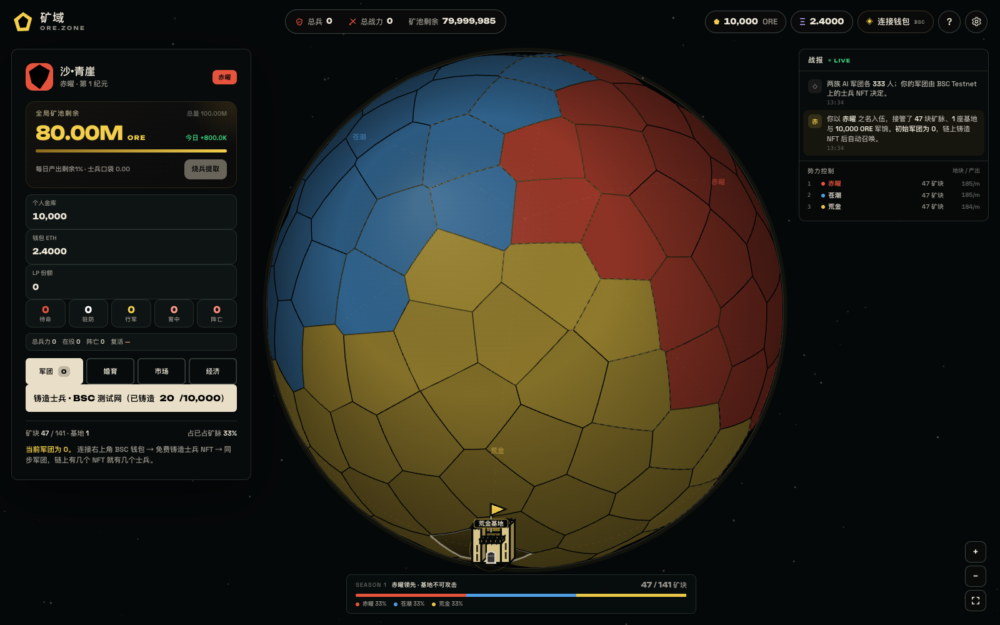

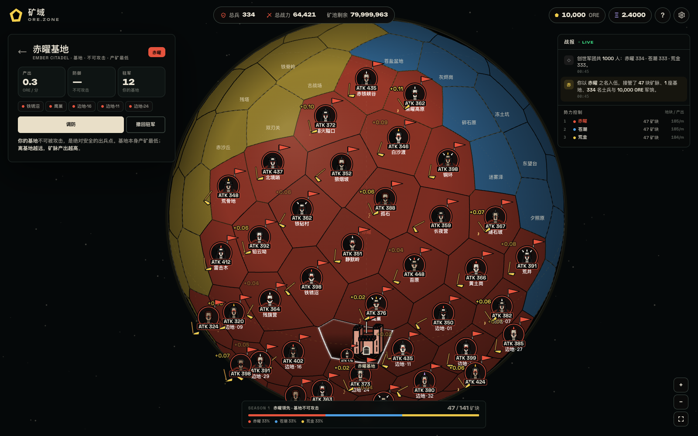

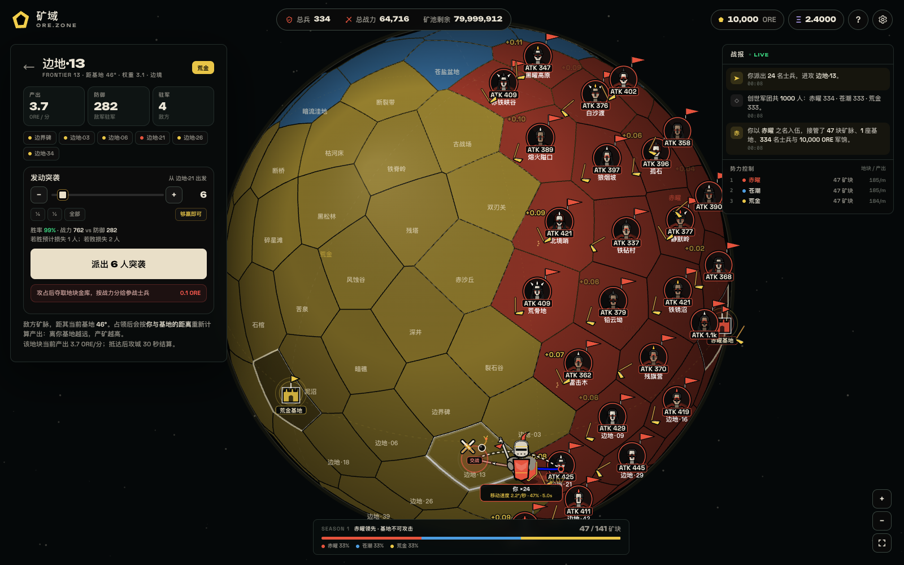

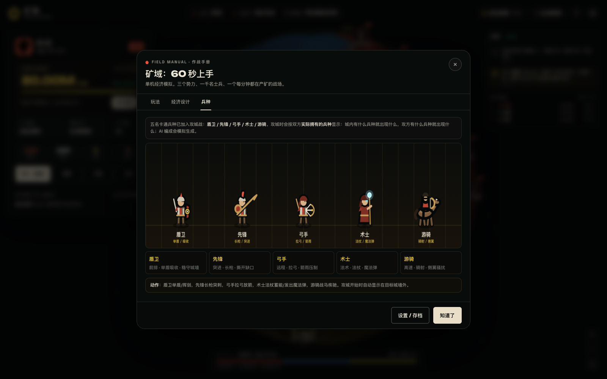

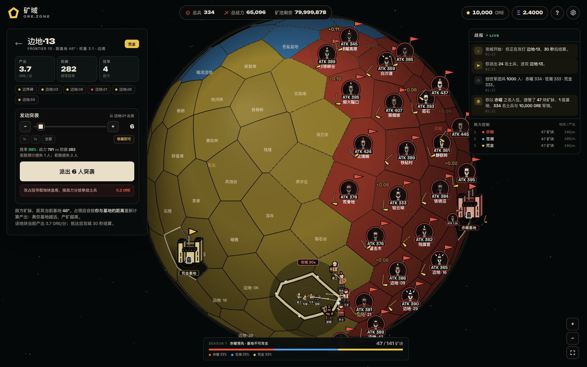

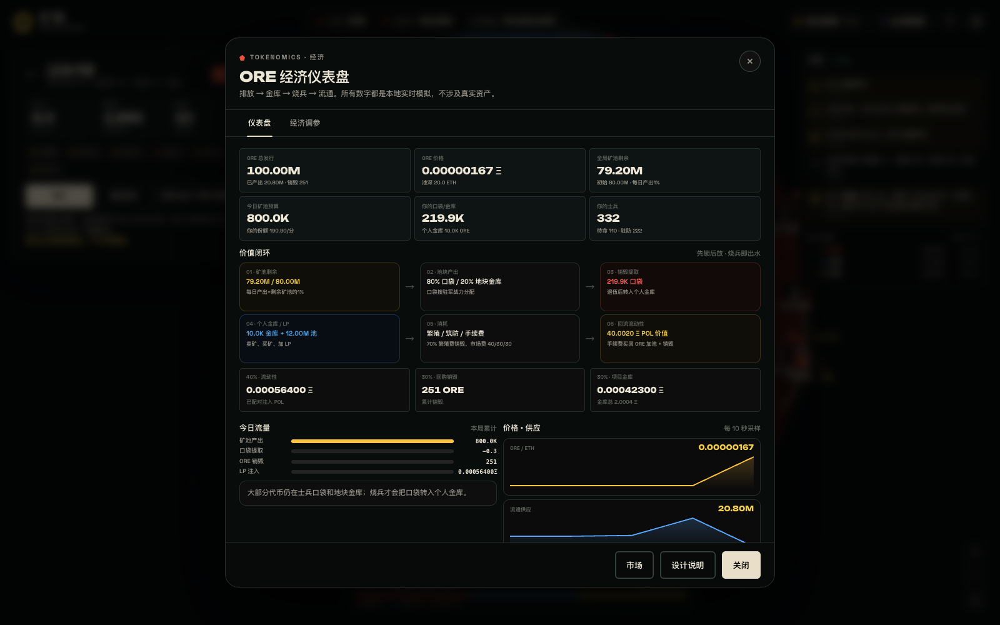

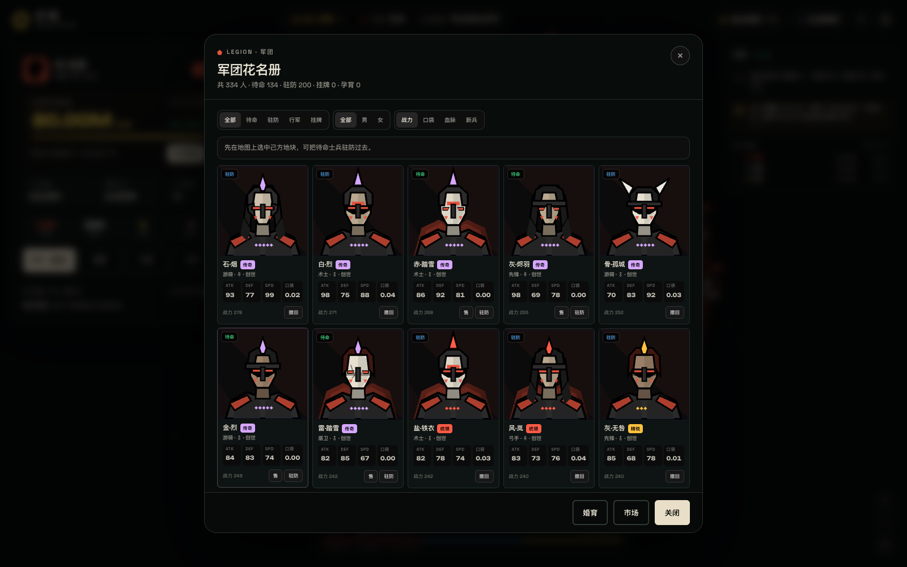

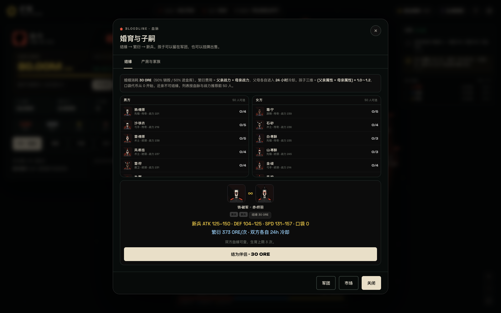

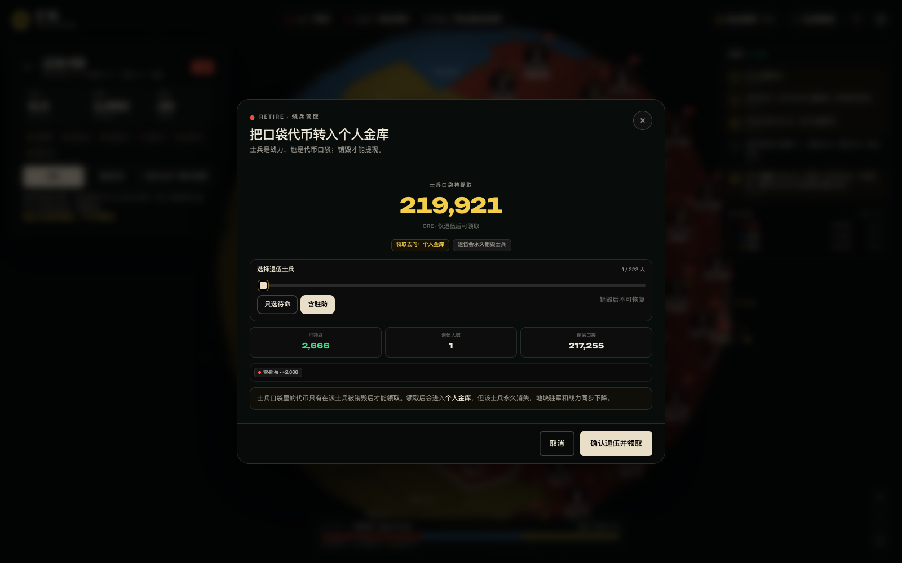

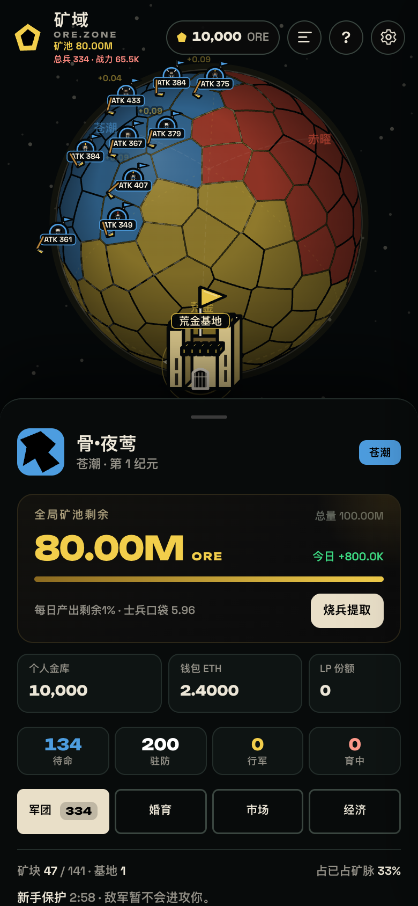

---

## 球体战场

地图是 **144 个球面 Voronoi 领地**，三种颜色完整铺满整个球体，没有中立空白：

| 类型 | 数量 | 规则 |
|---|---:|---|
| 基地 | 3 | 每族 1 座，在球面上互相**等距 120°**；不可被攻击/占领；产矿最低 |
| 矿脉 | 141 | 开局按经度扇区均分：每族 **47 块矿脉 + 1 座基地 = 48 格** |

- 三座基地分别位于赤道上的 0° / 120° / 240°，两两球面距离精确为 **120°**。
- 每个势力以自家基地为**正中心**，拥有一个 120° 的球面扇区；颜色覆盖全球。
- **基地中心产矿最低，离自己基地越远产矿越高**。
- 被占领的矿脉会立刻改按**新主人与自己基地的距离**重算产出——抢来的远疆可能很富，抢来的腹地可能很穷。
- 己方驻军所在的城市会显示**一个军团花名册头像**（每块地最多 1 个）+ **阵营旗标** + 该地块驻军的 **ATK 总攻击力**；
- 每个驻军地块上还有**每秒挥动一次的锄头动画**，并飘出该地块**每秒产出的 ORE 数值**（例如 `+0.13`）。缩放后还会显示地块名与当前产出。
- 移动士兵时，会沿球面行进**更大的阵营配色重装骑士图标**（森林绿骑士、沙漠金骑士、南极蓝骑士），并显示完整虚线路径、方向箭头、移动速度、进度和剩余时间。
- 正在交战的格子会显示**交叉双剑 + 炸弹 + “交战”标签**；战斗结算后再保留约 3 秒。

初始配置：

- 全图 144 格全部有主：**每族 48 格 = 47 矿脉 + 1 基地**。
- 玩家：**0 名初始士兵**；军团由 BSC Testnet 上持有的士兵 NFT 决定，最多 10 个。
- AI 两族：各 **188 矿脉驻军 + 12 基地驻军 + 133 野战军**（模拟总数 333）。
- 矿脉驻军 4/块，基地驻军 12。

---

## 战后地块战报

战斗结束后，被攻击地块上方会显示一张战报卡，不会和地块名称/产出重叠：

- **阵亡行**：按势力色显示「森林王国 阵亡 7」
- **守方阵亡**：如果双方都有损失，会再显示一行守方阵亡
- **掠夺行**：金色显示「森林王国 掠夺 +1,280 ORE」
- 同一地块的新战报会替换旧战报
- 多张战报屏幕位置接近时会自动上下错开
- 绘制在所有地块图标、头像、部队和标签之上，不会被遮挡
- 约 6 秒后淡出

## 战场音效

游戏使用录音级空间音效，而不是纯合成音：

- **刀剑战斗**：真实刀剑对撞录音，按战斗地块在球面上的位置做左右声像和远近衰减
- **行军**：真实军队整齐步伐录音，随行军位置移动
- **采矿**：真实镐头敲击矿石录音，只在自己有驻军的地块播放
- **战号 / 箭矢**：攻城开始和战斗中的点缀音

声音在球体正前方居中时最大；地块随地球转到右侧时声音偏右并变远，转到左侧时偏左并变远，转到背面时衰减。音效开关在顶栏。

音效文件来自 FreeSound，授权与作者见 `audio/ATTRIBUTION.md`；不是《帝国时代 2》的专有音频。

## 多人同服

启动本地自托管 PostgreSQL + Redis + 服务器：

```bash
pnpm install
node server/local-dev.js
```

或者连接托管 PostgreSQL/Redis：

```bash
DATABASE_URL=postgres://... REDIS_URL=redis://... node server/world-server.js
```

然后打开：

```text
http://192.168.10.108:8080/index.html?mp=1
```

大厅里也有「多人同服」按钮。服务器负责钱包签名登录、NFT 初始兵力、链上 ORE 读取显示、游戏 ORE 账本、地块归属、兵力、攻击、30 秒战斗、招募、婚育、士兵市场、LP、排行榜；使用 SQLite 持久化。一个钱包只能加入一个势力；不同钱包可以加入不同势力。当前是一张 144 地块的势力共享世界，不做独立基地和分片。

多人 HUD 现在是左侧指挥面板、右侧战报，与单人布局对齐；额外保留 War / Legion / Breeding / Market / Liquidity 标签。链上 ORE 与游戏 ORE 分开显示。

详细规则、接口、安全和启动方式见 [MULTIPLAYER.md](MULTIPLAYER.md)。

## 多语言

右上角语言按钮支持：

- English
- 中文（繁體）
- Français
- Русский
- 日本語
- 한국어
- Tiếng Việt
- العربية

选项以各自语言显示，首次打开默认 **English**。语言选择保存在 `localStorage["ore.lang"]`，切换后刷新页面；界面文字、势力名、兵种名、地图标签和主要弹窗会同步切换，阿拉伯语自动使用 RTL。中文（繁體）界面已把 Wallet、Pool、Tiles、Testnet、Season、Live、Genesis 等英文词语改成中文，只保留 ORE、NFT、BSC、ATK、DEF、LP、ETH 等缩写。深层弹窗、市场、婚育、帮助、战斗战报、提示语等文本也加入了多语言覆盖；玩家士兵名在非中文界面显示为拼音/英文形式，中文（繁體）显示繁體字形。

## 电脑 / 手机响应式 UI

- 桌面：顶栏统计、左侧指挥面板、右侧战报栏
- 平板 / 窄屏：战报变为抽屉，语言菜单仍在右上角
- 手机：底部指挥面板、顶栏精简、地图文字自动缩放、战报抽屉
- 长语言文本：按钮自动增高换行，标签可换行，顶部统计在窄屏隐藏文字只保留图标
- 阿拉伯语：自动 RTL，菜单和文本方向适配

已用 1600 / 1280 / 1024 / 768 / 600 / 390 / 320 宽度和法语、俄语、阿拉伯语做过布局检查，无横向溢出。

## 3D 星球地貌

默认地图现在是 **WebGL 真 3D 星球**：Three.js 球面高度网格 + 方向光 + 阴影 + 两类 3D 树木（针叶/阔叶）+ 3D 基地城堡 + 海洋/雪山/草原/森林。山体高度和半径随机拉开，树木大小从很小到很大；草地、沙漠、湖海、森林、雪帽使用“中心深、外围浅”的径向色。领地格子的填充和边缘都使用同一个势力颜色，普通地块边界改为浅色，势力归属靠填充和边缘色区分。WebGL 不可用时自动回退到 Canvas 地貌。

- 海洋 / 海岸线
- 连续山脉带、雪帽山峰、高原台地
- 森林树冠、草原、沙丘
- 湖泊、河流
- 3D 基地城堡
- 红蓝黄领地细边框

**设置 → 地图外观** 可以在「3D 地貌」和「势力色块」之间切换；原来的红蓝黄模式仍然保留。

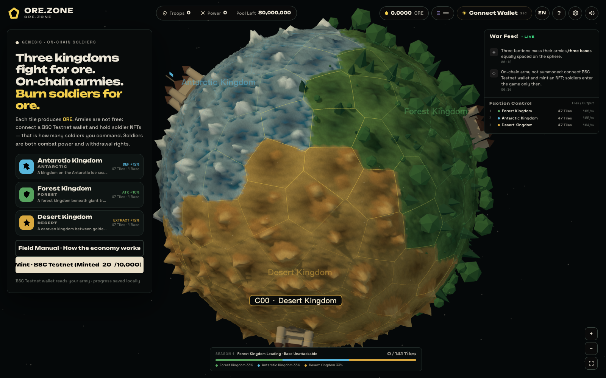

## 时间校验

游戏时钟优先使用签名服务 `GET /time` 的服务器时间 + 单调 `performance.now`，并拦截页面打开期间的系统时间前跳；刷新后重新同步。详见 [SECURITY_AUDIT.md](SECURITY_AUDIT.md)。

## 钱包 ETH

左侧「钱包 ETH」和顶栏数字读取当前区块链网络的主币余额（BSC Testnet 下为 tBNB）；标签沿用 ETH，不再显示游戏内 ETH 记账。未连接钱包时显示「—」。

## 三势力地貌与地块编号

每个地块都有固定编号，格式为「字母 + 两位数字」，按初始势力与球面位置规律排序：

- **A00–A47**：南极王国
- **B00–B47**：森林王国
- **C00–C47**：沙漠王国

`00` 是王城基地，其余按纬度、经度依次编号。地块被谁占领，就显示谁的 3D 地貌：

- **南极王国**：蓝冰、雪山、深蓝海水
- **森林王国**：绿色草地、深浅森林与 3D 树木
- **沙漠王国**：金黄色沙地、土山与金色岩峰

占领后 WebGL 地形会按新归属重建，所以地块会直接变成占领者的地貌。每个地块内部采用“中心深、外围浅”的径向色，山体和树木大小随机分布。

## 链上军团

> **士兵 ID = NFT tokenId**：NFT `#1` 在游戏里就是士兵 `id=1`，花名册显示 `#1`；旧存档的 `nft1` 会自动迁移为 `1`，驻军、配偶、子嗣与市场引用一起改写。
>
> 同步时会同时统计 **在役 + 阵亡等待复活** 的 NFT；链上仍持有、但游戏里既不在役也不在阵亡名单的 token（例如旧版本永久阵亡的士兵），会重新召唤，避免出现“链上 10 个、游戏只有 5 个”。

> 军团来源改动后存档升级为 **v9**；旧的 v8 免费士兵存档会被忽略，需要重新入伍。

游戏不再赠送 334 名创世士兵。铸造入口有三处：**左侧指挥面板的「铸造士兵 · BSC 测试网（已铸造 X/10,000）」按钮**、**右上角钱包地址**、**设置 → BSC 测试网士兵**。

玩家的军团来源只有一条：

1. 右上角连接 **OKX / Binance Web3 / MetaMask / Trust / Coinbase / Rabby / Bitget** 等钱包。
2. 切换到 **BSC Testnet / chainId 97**。
3. 在 **设置 → BSC 测试网士兵** 免费铸造士兵 NFT。
4. 合约的 `tokensOfOwner` 返回几个 token，游戏军团就有几个士兵。

- 没有 NFT：军团为 **0**，顶部总兵数显示 0。
- 铸造后：点击“同步军团”或重新连接钱包，NFT 自动变成游戏内士兵。
- NFT 转出后再次同步，对应游戏士兵会被移除。
- 链上士兵初始为待命状态，需要自己调入地块驻防。
- **战斗阵亡是自动的**：驻军被攻击、攻城失败会进入阵亡名单，**10 分钟后在基地复活并编入基地驻军**；只有「烧兵提取」是手动永久销毁，不存在系统自动退伍。
- 左侧显示 **总兵力 / 在役 / 当前阵亡 / 最近复活倒计时**；军团花名册里每个阵亡士兵单独显示复活倒计时。
- 当前合约每地址最多 10 个，所以玩家链上军团最多 10 人。
- 铸造按钮只铸造“当前地址剩余额度”：例如已铸造 8 个，按钮显示“免费铸造 2 个”，不会固定发送 10 个导致 revert。
- 繁衍与市场买人只能使用“链上名额”的空位：军团人数不会超过当前持有的 NFT 数量；没有 NFT 时不能凭空增兵。

---

## 游戏 ↔ 链上

目前的双向交互：

- **读取**：连接钱包读取 `tokensOfOwner`，把 NFT 同步为游戏士兵。
- **铸造**：链上 `mint(uint256)` 成功后自动同步。
- **烧兵**：选中 NFT 士兵并确认退伍时，游戏会让钱包调用 ERC-721 `transferFrom(owner, 0x…dEaD, tokenId)`，把 NFT 永久转入销毁地址；等待交易确认后才销毁游戏士兵并把 ORE 计入个人钱包。
- **验证**：烧毁前读取 `ownerOf`，烧毁后等待交易回执；个人钱包下方显示最近一次 BscScan Tx。

> ORE 已部署为 BSC Testnet ERC20，由 `OreVault` 持有；游戏内 ORE 与链上 ORE 通过“提取 / 充值”双向流动，本地账本用 `onchainNet` 对账。详见 [ORE_ONCHAIN.md](ORE_ONCHAIN.md)。

## 阵亡与复活

- 战斗阵亡的士兵会在 **10 分钟后于基地复活**，并自动编入基地驻军。
- 左侧指挥面板实时显示：**总兵力 / 在役 / 当前阵亡 / 最近复活倒计时**。
- **军团花名册**底部有“阵亡 · 等待复活”列表，每名士兵单独显示 `MM:SS` 复活时间。
- 阵亡不是自动退伍；只有手动「烧兵提取」才会永久销毁士兵并领取口袋。

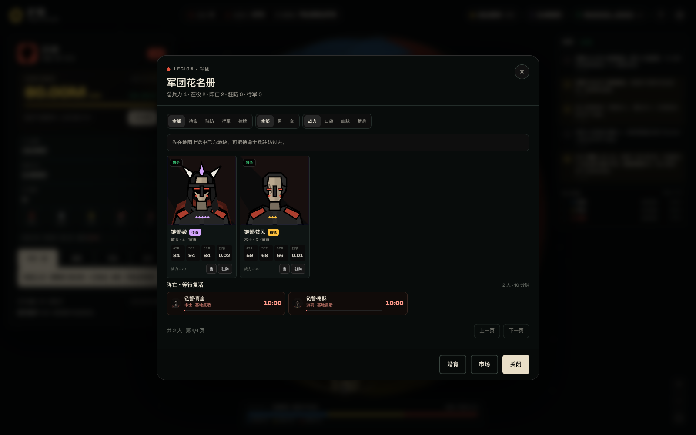

---

## 距离产矿

```
基地权重       = 0.22
矿脉权重       = 0.35 + 6.2 × (距自己基地的球面角 / 90°)^1.2
地块每天份额   = 权重 × 今日矿池预算 / 全图总权重
地块 80%       → 驻军士兵口袋（按战力）
地块 20%       → 地块金库
```

- 基地本身权重最低，产出也最低。
- 离自己基地越远，权重和产出越高。
- 地块被打下后，距离按新主人的基地重算；地块金库被胜方夺走。
- 每天预算 = 当天开始时矿池剩余 × 1%。
- 地块金库与士兵口袋里的代币都不是自由流通余额。

---

## 经济模型

### 1. 总量与矿池

```
代币总发行量       100,000,000 ORE
游戏矿池初始总量    80,000,000 ORE
初始流通/金库/流动性 20,000,000 ORE
```

- 页面顶部实时显示 **矿池剩余数量**。
- 游戏内每天总产出 = **当天开始时剩余矿池的 1%**。
- 矿池剩余越少，之后每天产出越少。
- 产出按球面地块权重分配；离自己基地越远，地块权重越高。
- 矿池剩余为 0 后不再有新挖矿产出。
- 当前存档版本 **v8**。

### 2. 地块产出：80% 口袋 / 20% 地块金库

每块矿脉当天的产出按以下方式拆分：

```
80% → 该地块驻军士兵的口袋（按战力分配）
20% → 该地块金库
```

- 士兵攻击力属性栏新增 **口袋**：显示该士兵持有的代币数量。
- 驻军士兵按 `ATK + DEF + SPD` 战力占比分配。
- 没有驻军的地块，80% 份额保留在地块金库。
- 地块金库会随战争易手：
  - 玩家攻占成功：金库按参战存活士兵战力分进各自口袋；
  - AI 攻占成功：金库进入 AI 势力口袋池。
- 地块金库是持续累积的 20% 产出，不是一次性奖励；攻方夺走的是整个地块金库。

### 3. 士兵销毁 → 口袋转入个人钱包

- 士兵口袋里的代币**不能直接卖**，也不能直接转走。
- 必须通过 **烧兵领取**：永久销毁该士兵，口袋代币才进入玩家 **个人钱包**。
- 士兵在战斗中死亡，也会把口袋代币转回个人钱包。
- 口袋代币进入个人钱包后，才可以用于：
  - 结缘、繁衍、筑防
  - 市场买卖
  - 注入 AMM 流动性
- 带口袋代币的士兵不能挂牌出售，避免绕过销毁提取。

### 4. AMM 与手续费

初始 2000 万流通分配：

- AMM 池：**12,000,000 ORE + 20 ETH**
- 项目金库：**8,000,000 ORE**
- 玩家入伍军饷：**10,000 ORE**（从金库划转）

市场手续费仍为 **6%**：

| 去向 | 比例 | 动作 |
|---|---|---|
| 协议流动性 POL | 40% | 手续费 ETH + 金库 ORE 配对加池 |
| 回购销毁 | 30% | 用手续费 ETH 买 ORE 并销毁 |
| 项目金库 | 30% | ETH 进金库 |

AMM 兑换费 **1%** 留在池中，LP 受益。

### 5. 每日结算规则

- 每天开始时锁定 `dayBudget = minePool × 1%`。
- 当天产出按秒/分钟释放到地块，再拆成 80/20。
- 当天未释放完的预算不会滚入下一天；下一天按新的矿池剩余重新计算 1%。
- 矿池、个人钱包、士兵口袋、地块金库、AMM 池共同构成完整账本。

### 6. 新兵属性继承

男兵与女兵繁衍出的新兵：

```
新兵 ATK = round((父亲 ATK + 母亲 ATK) × r1)   r1 ∈ [1.0, 1.2]
新兵 DEF = round((父亲 DEF + 母亲 DEF) × r2)   r2 ∈ [1.0, 1.2]
新兵 SPD = round((父亲 SPD + 母亲 SPD) × r3)   r3 ∈ [1.0, 1.2]
新兵口袋代币 = 0
```

- 三条属性各自独立随机 **1.0～1.2** 倍，所以同父母的多名新兵属性会有差异。
- **不设 99 属性上限**，强强联合可以培养出超过 99 的新一代士兵。
- 新兵口袋从 0 开始，不会继承父母口袋里的代币。
- 职业随机继承父母职业；品阶按原有概率浮动。
- 繁衍一次的费用 = **父亲战力 + 母亲战力**，从个人钱包支付。
- 父亲、母亲各自进入 **24 小时**冷却，从本次繁衍开始时计时；孕育仅 45 秒。
- 新兵初始待命，需手动驻防后才会开始获得地块产出口袋。

### 7. 可调参数

目前可调：

| 参数 | 默认 | 范围 | 作用 |
|---|---:|---:|---|
| 市场费率 | 6.0% | 2%–12% | 调整交易摩擦与 LP |

每日产出比例 **1%** 是协议固定规则，不在调参里修改。

## 五兵种

游戏内五个职业都已有独立的卡通动作单位，可在 **作战手册 → 兵种** 中查看实时动画：

| 兵种 | 定位 | 动作 |
|---|---|---|
| 盾卫 | 前排承伤 | 举盾、挥剑 |
| 先锋 | 突击 | 长枪突刺 |
| 弓手 | 远程物理 | 拉弓、放箭 |
| 术士 | 远程法术 | 法杖蓄能、魔法弹 |
| 游骑 | 侧翼机动 | 战马疾驰、骑射 |

攻城时按双方**实际兵种编成**显示：城墙内有什么兵种就出现什么，攻方有什么兵种就出现什么；AI 战斗会模拟生成编成。取代原来的投石车与固定双弓手。

## 战斗与防守

- 只能从相邻己方矿脉/基地出兵；**三座基地不可被攻击、不可被占领**。
- 部队抵达后进入 **30 秒攻城战**，不再瞬间结算：
  - 城墙内按该地块**实际驻军兵种**显示卡通单位；有弓手才射箭，有术士才放魔法弹；
  - 城外按攻方**实际参战兵种**显示卡通单位，围住城墙；
  - AI 战斗由于没有个体士兵，会模拟生成双方编成；
  - 原投石车已移除，所有单位都有独立动作；
  - 地块上方显示 `攻城 XXs` 倒计时，30 秒后结算胜负。
- 防御 = 矿脉权重 + 筑防等级 + 驻军 DEF（南极王国 +12%）；基地只显示“不可攻击”，不需要防御。
- 进攻战力 = 士兵 ATK（森林王国 +10%）+ 速度。
- 胜利后幸存者自动驻防，并夺取该地块金库，按战力分给参战士兵口袋。
- 失败会损失士兵；驻防士兵可被击杀，剩余驻军会撤回待命。
- AI 两族会沿 120° 边界互相攻击，并在新手保护结束后进攻玩家。

---

## 技术说明

- 纯 HTML/CSS/Canvas/原生 JS，无依赖、无构建。
- 地图由 144 个球面 Fibonacci 点生成 **3D Delaunay → 球面 Voronoi** 领地；三座基地被精确吸附到赤道 0°/120°/240°，两两夹角 120°。
- 球体会**自转**；支持拖拽 360° 旋转、上下翻转、滚轮/双指缩放。
- 领地颜色按三族扇区铺满全球；基地用城塞图标、白/金描边和“基地”标签标识。
- 士兵、头像、名字、属性均为程序化生成。
- 主游戏经济、市场、战斗都是本地模拟；军团来源需要连接钱包读取 BSC Testnet NFT，只有免费 mint 会发送测试网交易。
- **设置 → BSC 测试网士兵**：连接钱包、免费 mint；链上 NFT 会同步为游戏军团，没有 NFT 时军团为 0。
- 存档：`localStorage`，支持导出/导入 JSON；刷新/重开页面会自动恢复驻军城市、头像、ATK 与锄头动画。旧存档里缺失的 `garrisonIds` 会按 `soldier.zone` 自动修复。
- 离线最多结算 8 小时矿脉产出，离线不结算战争。当前存档版本 **v8**。

本项目是对该玩法方向的独立原型，与 evm.zone 官方无关。
---

## BSC Testnet 士兵合约

10,000 个士兵 NFT，免费铸造，每个地址生命周期最多 10 个：

- 合约：`0x712716b1a7a991a372d951A6873f42665918BA9a`
- 网络：BSC Testnet（chainId 97）
- 浏览器：[testnet.bscscan.com](https://testnet.bscscan.com/address/0x712716b1a7a991a372d951A6873f42665918BA9a)
- 部署记录：`build/deployment.json`
- 部署说明：`DEPLOY_BSC_TESTNET.md`

部署者已铸造 #1–#10 做上限测试，第 11 个 `mint` 已 revert；链上总铸造 20 / 10,000，当前剩余 9,980 个。


---

## 矿池合约

`OreMinePool`：`0x24Fe1fBAaAeE078ff918f8aFF8DE1AD58B7F8506`，持有 80,000,000 ORE。领取 ORE 时先把待结算产出从矿池释放到 Vault，再执行签名领取；顶部矿池剩余在连接钱包后直接读取链上矿池余额。

## 烧兵即到账（矿池直付）

烧兵不再「先进游戏个人钱包、再手动提取」，而是**销毁 NFT 后由签名服务直接从矿池打币到钱包地址**：

1. 前端调用 `OreBurner.burnBatch` 把选中的 NFT 转入 `0x…dEaD`，等待回执 `status=1`；
2. 前端 `POST /burn-payout`（`server/claim-server.js`），携带 `{ player, amount, burnTx }`；
3. 签名服务校验该销毁交易里确实存在 `Transfer(player → 0x…dEaD)`，再调用 `OreMinePool.release(player, amount)`；
4. ORE 直接从矿池进入玩家钱包，**不经过游戏内记账**；「个人钱包 / 顶栏 ORE」显示的就是链上 `OREToken.balanceOf(wallet)`。

若第 3 步校验或打币失败，前端回退到原来的「计入游戏内金库」路径，并在个人钱包下方显示失败原因。

## 批量烧兵

`OreBurner` 已部署：`0xc3DD4CFf1fc205974cF69b5B64D1FFc9405Bb917`。首次使用需要一次 `setApprovalForAll` 授权（**作用域仅限士兵合约 0x48AE…fD4 这一个系列**，其他 NFT 系列完全不受影响；授权可在个人钱包下方一键撤销）；之后一批 NFT 通过 `burnBatch` 用**一笔交易**批量销毁（最多 500 个），不再一个 NFT 一笔交易。

## ORE 链上金库

ORE 已部署为 BSC Testnet ERC20，并由 `OreVault` 持有；完整地址、签名领取服务、充值/提取流程与安全边界见 **[ORE_ONCHAIN.md](ORE_ONCHAIN.md)**。

- ORE ERC20：`0xD222B7BC58AF20a5EE2bF877A9008091Da3D00E5`
- OreVault：`0xfd6518D066ceddd5b4Bd100cAa17B7Fa504fFC62`
- 签名服务：`node server/claim-server.js`（默认 `:8090`）

---

## 安全审计

当前版本存在客户端账本可篡改、`/claim` 信任客户端金额等严重问题。详见 **[SECURITY_AUDIT.md](SECURITY_AUDIT.md)**。签名服务默认处于安全模式，`/claim` 与 `/burn-payout` 返回 503；本地游戏可玩，但链上领取需要先完成服务端权威账本重构。
